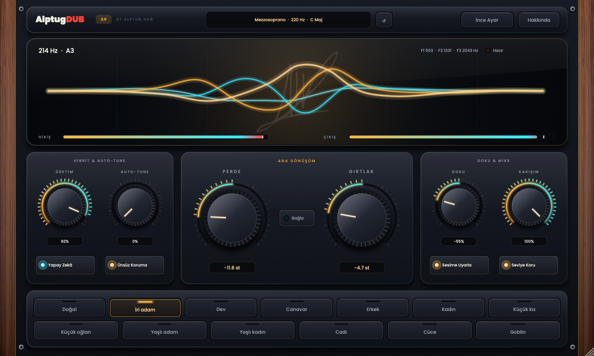
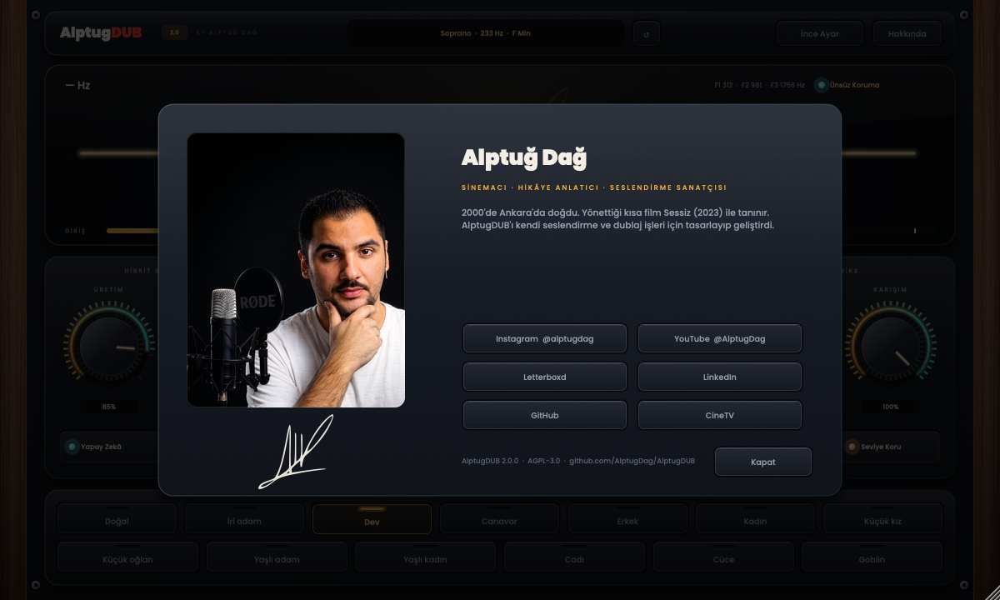

# AlptugDUB

**Seslendirme ve dublaj için hiper-gerçekçi hibrit ses motoru ve uyarlanabilir Auto-Tune: iri bir adam, küçük bir kız, canavar, cadı… hepsi kendi sesinizden.**
*Hyper-realistic hybrid voice regeneration & human-voice Auto-Tune for voice-over and dubbing. English below.*



VST3 · Audio Unit · macOS 11+ · Apple Silicon ve Intel (universal)

---

## Ne yapar (2.0.0)

AlptugDUB 2.0 yalnızca perde/formant kaydırmakla kalmaz; sesinizi kaynak-filtre bileşenlerine ayırıp **ses tellerini sıfırdan yeniden üretir (`Hybrid Regeneration`)**, ünsüzleri bozulmadan korur (`Consonant Guard`) ve insan sesi için optimize edilmiş akıllı **Auto-Tune** uygular.

- **Ses-Reaktif Modern Arayüz:** Canlı sese göre oynayan çok katmanlı dalga ekranı, sağda dev **Perde (±18 st)** ve **Gırtlak (±8 st)** kadranları, solda hızlı karakter sekmeleri ve tüm 13 karakter menüsü.
- **Hibrit Yeniden Üretim Motoru:**
  - **Doğrusal Olmayan F1/F2/F3/F4 Formant Bükme (`VocalTractWarper`):** Gerçek kepstral liftering ile gırtlak/ağız yolu rezonanslarını insan anatomisine göre ayrı ayrı büker; "sincap" ya da boğukluk etkisini yok eder.
  - **LF-Model Glottal Sentez & Alt Harmonikler (`Üretim`, `Doku`, `Hırıltı`):** 8 açık-faz × 6 oktav bant-sınırlı glottal dalga tablosu üzerinden göğüs/kafa sesi dengesini, `F0/2–F0/3` alt harmoniklerini ve perdeyle eşzamanlı formant-şekilli nefesi sıfırdan sentezler.
  - **24-Bark Sinirsel Tını Şekillendirici:** Öğrenilen ses profilinizi hedef karakterin tını imzasına göre doğrusal olmayan şekilde dengeler.
  - **Ünsüz Koruma (`Consonant Guard`):** `s, ş, f, ç, t, k, p` gibi sert ve sürtünmeli ünsüzleri perde kaydırmasına sokmadan kristal netliğinde korur.
- **Akıllı İnsan Sesi Auto-Tune:** Konuşmacının veya şarkıcının tonalitesini (Majör / Minör / Kromatik) otomatik algılar; doğal insan vibratosunu koruyarak (`%0–%65`) ya da stüdyo kilidiyle (`%65–%100`) notaya oturtur.
- **Gizli İnce Ayar Çekmecesi (`İnce Ayar`):** Ana ekranı sade tutmak için `Nefes`, `Yaş`, `Geniz`, `Gövde`, `Hava`, `Netlik` ve 9 motor anahtarı üst bardaki **İnce Ayar** panelinde toplanmıştır.
- **Yapay Zekâ ile Ses Analizi ([SwiftF0](https://github.com/lars76/swift-f0)):** Makinenizde internet gerektirmeden çalışır; gecikme (`latency`) DAW'a bildirilir ve tam hizalanır.
- **Güvenli Çıkış:** Zincirin sonunda yalnızca aşımlarda devreye giren `−0,3 dBFS` koruma limitleyicisi bulunur.

## Kurulum

1. [Releases](https://github.com/AlptugDag/AlptugDUB/releases) sayfasından `AlptugDUB-2.0.0-macOS.zip` dosyasını indirin ve açın.
2. Terminal'de klasörün içinde çalıştırın:

   ```bash
   sh install.sh
   ```

   (Tüm kullanıcılar için: `sudo sh install.sh -a`.) Betik eklentileri `~/Library/Audio/Plug-Ins` altına kopyalar ve indirme karantinasını kaldırır.
3. DAW'ınızda eklentileri yeniden taratın. AlptugDUB, üretici **Alptuğ Dağ** altında görünür.

## Kaynaktan derleme

```bash
cmake -S . -B build -G Ninja -DCMAKE_BUILD_TYPE=Release "-DCMAKE_OSX_ARCHITECTURES=arm64;x86_64"
cmake --build build --target AlptugDUB_VST3 AlptugDUB_AU AlptugDUBSnapshot
```

JUCE 9.0.4 ve Signalsmith Stretch 1.4.0 derleme sırasında sabit sürümleriyle indirilir. Xcode Command Line Tools yeterlidir.

Test araçları:

- `AlptugDUBSnapshot --render giriş.wav çıkış.wav <karakter>`: tüm eklenti zincirini bir dosyadan geçirir.
- `AlptugDUBSnapshot --stress`: 44,1/48/96 kHz, mono/stereo, değişken blok boyutları, tüm karakterler.
- `tools/swiftf0/check.py`: C++ sinirsel modeli orijinal ONNX modeliyle karşılaştırır.

---

## English

AlptugDUB 2.0 upgrades spectral pitch shifting into a **hybrid voice regeneration engine** with **adaptive human-voice Auto-Tune** and a clean, voice-reactive studio interface:

- **Non-linear Anatomical F1/F2/F3/F4 Formant Warping** via true liftered cepstral source-filter separation (`VocalTractWarper`).
- **LF-Model Glottal Resynthesis & Subharmonics (`HybridRegenerator`):** Band-limited glottal source with open-quotient (`Glottal`) chest/head shaping, `F0/2–F0/3` subharmonic `Growl`, pitch-synchronous formant-shaped `Breath`, and an embedded 24-Bark neural timbre shaper.
- **Multi-Band Consonant Guard:** Preserves unvoiced sibilants (`s, sh, f`) and plosives (`t, k, p`) unshifted while regenerating voiced vowels.
- **Adaptive Human-Voice Auto-Tune (`AutoTune`):** Automatically detects the speaker/singer's musical key and scale via Krumhansl-Schmuckler chroma correlation, preserving natural vibrato and adapting retune speed to learned `VoiceType`.
- **Voice-Reactive Minimalist UI & Hidden Fine-Tune Drawer:** Real-time harmonic wave visualizer, Pitch & Formant ring dials, quick preset tabs, bottom texture dock, and a collapsible **Fine Tune** drawer for `Breath`, `Age`, `Nasal`, `Body`, `Air`, `Presence`, and all 9 engine toggles.
- **Install:** Download `AlptugDUB-2.0.0-macOS.zip`, run `sh install.sh`, and rescan plug-ins in your DAW.

## Yapımcı / Author

<p>
  <picture>
    <source media="(prefers-color-scheme: dark)" srcset="docs/signature-light.svg">
    
  </picture>
</p>

**Alptuğ Dağ**: sinemacı, hikâye anlatıcı, seslendirme sanatçısı. / Filmmaker, storyteller, voice artist.

[Instagram @alptugdag](https://instagram.com/alptugdag) · [YouTube @AlptugDag](https://youtube.com/@AlptugDag) ·
[Letterboxd](https://letterboxd.com/AlptugDag/) · [LinkedIn](https://www.linkedin.com/in/AlptugDag/) ·
[GitHub](https://github.com/AlptugDag)



## Lisans / License

Kod GNU AGPL 3.0 ile yayımlanır (`LICENSE`). Üçüncü taraf bileşenler ve görseller için `CREDITS.md`'ye bakın; fotoğraf, imza ve "AlptugDUB" adı Alptuğ Dağ'a aittir.
