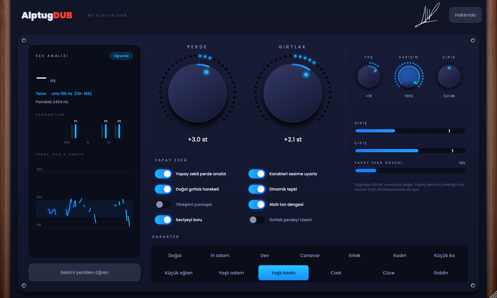
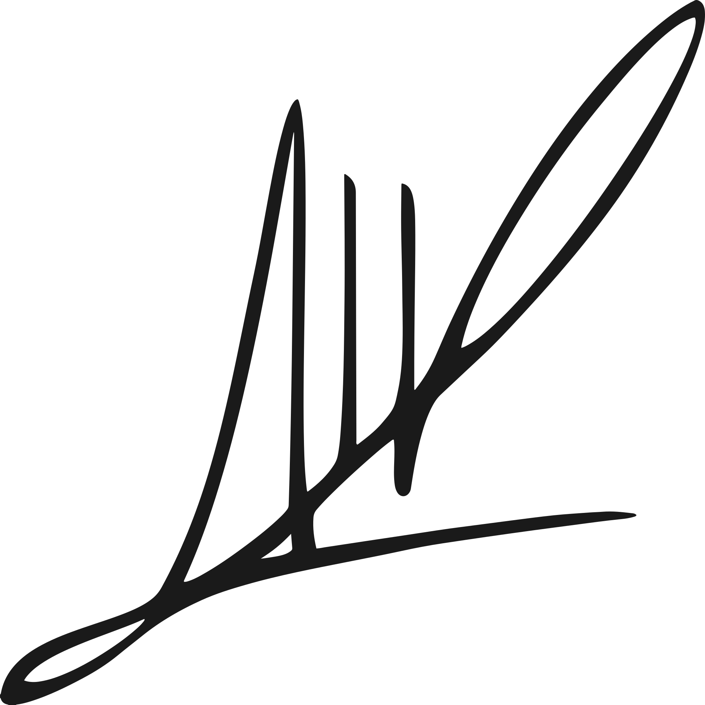
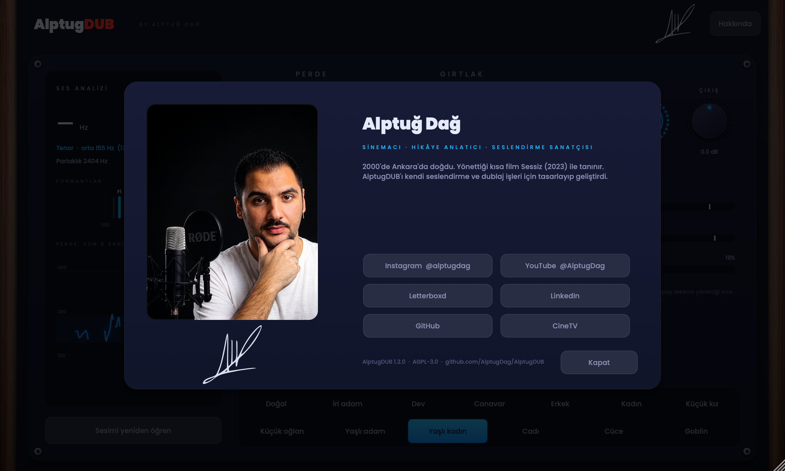

# AlptugDUB

**Seslendirme ve dublaj için ses karakterleri: iri bir adam, küçük bir kız, canavar, cadı… hepsi kendi sesinizden.**
*Voice characters for voice-over and dubbing, made from your own voice. English below.*



VST3 · Audio Unit · macOS 11+ · Apple Silicon ve Intel (universal)

---

## Ne yapar

AlptugDUB önce sesinizi dinler ve öğrenir (perde aralığı, ses tipi, formantlar, parlaklık), sonra perdeyi ve gırtlağı
(formantları) birbirinden bağımsız olarak değiştirir. Yankı ya da süsleme eklemez, gürültü katmaz; yalnızca sesin
kendisini dönüştürür.

- **Perde ve Gırtlak** büyük düğmelerdir. Perde ±18 yarım ton, Gırtlak ±8 yarım ton. Gırtlağı alçaltmak daha iri bir
  beden, yükseltmek daha küçük bir beden gibi duyulur.
- **Yaş** (−50 genç … +50 yaşlı), **Karışım** ve **Çıkış** küçük düğmelerdir.
- **12 karakter** ve Doğal: İri adam, Dev, Canavar, Erkek, Kadın, Küçük kız, Küçük oğlan, Yaşlı adam, Yaşlı kadın, Cadı,
  Cüce, Goblin. Hepsi öğrenilen sesinize göre ayarlanır.
- **Yapay zekâ ile ses analizi.** [SwiftF0](https://github.com/lars76/swift-f0) sinirsel perde modeli eklentinin
  içinde, makinenizde çalışır (internet yok, ek kurulum yok). Orijinal modelle sayısal olarak doğrulandı (perde farkı
  < 0,01 sent).
- **Anahtarlar:**

  | Anahtar | Ne yapar |
  | --- | --- |
  | Yapay zekâ perde analizi | Sesinizi sinirsel modelle öğrenir; kapalıyken hızlı analiz kullanılır |
  | Karakteri sesime uyarla | Ses öğrenildikçe karakterin perdesini ve gırtlağını sürekli yeniden hesaplar |
  | Doğal gırtlak hareketi | Perde yükselip alçaldıkça gırtlak da hafifçe hareket eder (en çok ±2 yarım ton) |
  | Dinamik tepki | Ton sesin şiddetini izler: bağırınca daha parlak ve belirgin, kısılınca daha yumuşak ve sıcak |
  | Titreşimi yumuşat | Perdedeki titrekliği ve ani oynamaları yumuşatır |
  | Akıllı ton dengesi | Kalınlaşan sese göğüs, incelen sese hava ekler; ton donuklaşmaz |
  | Seviyeyi koru | İşlenmiş ses, orijinali kadar yüksek kalır |
  | Gırtlak perdeyi izlesin | Formantlar perdeyle birlikte biraz kayar |

  Genizden, Netlik, Gövde ve Hava ayarları DAW otomasyonunda da açıktır.
- **Güvenli çıkış.** Zincirin sonunda yalnızca aşımlarda çalışan −0,3 dBFS limitleyici; NaN ya da patlama asla çıkmaz.

Motor, spektral perde ve formant kaydırıcıdır ([Signalsmith Stretch](https://github.com/Signalsmith-Audio/signalsmith-stretch),
MIT). Gerçek bir kayıtla ölçüldü: tüm presetlerde sesli kısımların harmonik/gürültü oranı orijinalle aynı ya da daha iyi.

## Kurulum

1. [Releases](https://github.com/AlptugDag/AlptugDUB/releases) sayfasından `AlptugDUB-1.2.0-macOS.zip` dosyasını indirin ve açın.
2. Terminal'de klasörün içinde çalıştırın:

   ```bash
   sh install.sh
   ```

   (Tüm kullanıcılar için: `sudo sh install.sh -a`.) Betik eklentileri `~/Library/Audio/Plug-Ins` altına kopyalar ve
   indirme karantinasını kaldırır.
3. DAW'ınızda eklentileri yeniden taratın. AlptugDUB, üretici **Alptuğ Dağ** altında görünür.

Gecikme (latency) DAW'a bildirilir ve DAW tarafından dengelenir.

## Kaynaktan derleme

```bash
cmake -S . -B build -G Ninja -DCMAKE_BUILD_TYPE=Release "-DCMAKE_OSX_ARCHITECTURES=arm64;x86_64"
cmake --build build --target AlptugDUB_VST3 AlptugDUB_AU
```

JUCE 9.0.4 ve Signalsmith Stretch 1.4.0 derleme sırasında sabit sürümleriyle indirilir. Xcode Command Line Tools yeterlidir.

Test araçları:

- `AlptugDUBSnapshot --render giriş.wav çıkış.wav <karakter>`: tüm eklenti zincirini bir dosyadan geçirir.
- `AlptugDUBSnapshot --stress`: 44,1/48/96 kHz, mono/stereo, değişken blok boyutları, tüm karakterler.
- `tools/swiftf0/check.py`: C++ sinirsel modeli orijinal ONNX modeliyle karşılaştırır.

---

## English

AlptugDUB first learns the voice (pitch range, voice type, formants, brightness), then moves pitch and formants
independently. No reverb, no added noise: only the voice itself is transformed.

- Two big knobs (Pitch ±18 st, Formant ±8 st), three small ones (Age −50…+50, Mix, Output), 12 characters plus
  Natural, all tuned to the learned voice.
- On-device neural pitch analysis (SwiftF0, MIT) compiled into the plug-in; verified against the original ONNX model.
- Switches: AI analysis, fit character to my voice, natural tract motion, dynamic response, steady pitch, smart tone, keep level, formant follows pitch.
- A -0.3 dBFS safety limiter closes the chain.
- Engine: spectral pitch and formant shifting (Signalsmith Stretch, MIT).
- Install: download the release zip, run `sh install.sh`, rescan plug-ins.

## Yapımcı / Author

<p>
  <picture>
    <source media="(prefers-color-scheme: dark)" srcset="docs/signature-light.svg">
    
  </picture>
</p>

**Alptuğ Dağ**: sinemacı, hikâye anlatıcı, seslendirme sanatçısı. / Filmmaker, storyteller, voice artist.

[Instagram @alptugdag](https://instagram.com/alptugdag) · [YouTube @AlptugDag](https://youtube.com/@AlptugDag) ·
[Letterboxd](https://letterboxd.com/AlptugDag/) · [LinkedIn](https://www.linkedin.com/in/AlptugDag/) ·
[GitHub](https://github.com/AlptugDag)



## Lisans / License

Kod GNU AGPL 3.0 ile yayımlanır (`LICENSE`). Üçüncü taraf bileşenler ve görseller için `CREDITS.md`'ye bakın; fotoğraf,
imza ve "AlptugDUB" adı Alptuğ Dağ'a aittir.
